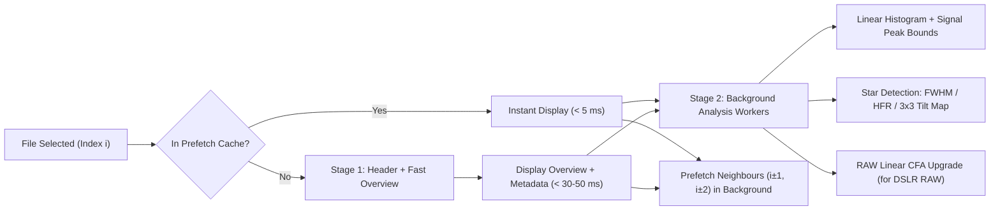

# FulgurPreView — Architecture Overview

This document describes the crate structure, data flow, threading model, and UI architecture of **FulgurPreView**, as specified in [PROJECT_SPEC.md](../PROJECT_SPEC.md).

---

## 1. Workspace Crates

`FulgurPreView` is organized as an independent, pure-Rust Cargo workspace with no external C/C++ dependencies and no cross-repository path dependencies on `FulgurStack`:

```text
fulgur-solve ───────────────────────────────┐
fulgur-core ──► fulgur-engine ◄─────────────┼── fulgur-catalog
                     │                      │
                     ▼                      ▼
              fulgur-preview (GUI & CLI binary: fulgur-preview.exe)
```

| Crate | Purpose & Modules Adapted from `FulgurStack` |
| --- | --- |
| `crates/fulgur-core` | Pure-Rust readers and metadata extractors:<br>• `fits`: Extended FITS reader supporting `BITPIX` `8`, `16`, `32`, `-32`, `-64`, 2D/3D cubes, Multi-Extension FITS (MEF) HDU enumeration, and atomic WCS header updates.<br>• `xisf`: Full XISF 1.0 reader and atomic WCS writer (LZ4, Zstd, Zlib, attached/embedded/external blocks).<br>• `raw`: Two-stage DSLR/mirrorless RAW reader (self-contained pure-Rust CFA decoders + embedded JPEG preview extractor, see ADR-008 / ADR-011).<br>• `standard`: Standard image reader (`image` + `tiff` + `kamadak-exif` for TIFF 8/16/32-bit, JPEG, PNG, WebP, BMP).<br>• `cameras` & `derive`: Embedded `cameras.json` database and header/filename metadata reconstruction. |
| `crates/fulgur-engine` | Real-time single-frame scientific processing:<br>• `stretch`: Linked and Unlinked MTF auto-stretch (median + MAD `sigma`), manual black/mid/white point mapping (CPU, parallel per row on the 2048 px overview). Measured 6 ms per redraw, so it stays on the CPU (ADR-016).<br>• `debayer` & `vng`: Fast 2×2 superpixel / MHC overview demosaicing and AVX2-accelerated VNG for 1:1 native detail crops.<br>• `histogram`: High-speed linear and stretched histogram computation with automatic **"Zoom to Signal"** bounds (`[black_floor .. median + N * sigma]`).<br>• `stars` (incl. 3×3 tilt map): Hot-pixel-robust star detector computing global median FWHM, HFR, eccentricity, sky background, noise, single-star PSF lookup under cursor, and the **3×3 Sensor Tilt & Corner Map**.<br>• `sky`: Gnomonic WCS projection, local Gaia cone solver, and polynomial distortion refinement. |
| `crates/fulgur-catalog` | Star and DSO catalogues (adapted from `FulgurStack`):<br>• `xpsd`: Local PixInsight Gaia DR3 `.xpsd` reader.<br>• `download`: Cached local Gaia DR3 tiles.<br>• `dso`: Built-in `deep_sky.csv` catalog for target lookup and field annotations.<br>• `config`: Automatic discovery of `%LOCALAPPDATA%\FulgurStack` catalogue paths so settings are shared seamlessly. |
| `crates/fulgur-solve` | Standalone blind plate solver using the `1.12 GB` Gaia DR3 quad index (`0.5°..12°` FoV). |
| `crates/fulgur-preview` | The `eframe`/`egui` (`glow` OpenGL 2.0) desktop application (`fulgur-preview.exe`):<br>• Directory scanner, natural/chronological sorter, and bounded LRU neighbour prefetch cache.<br>• Viewport with cursor-centered wheel zoom, pan, **Blink Mode** (view lock), 1:1 native detail streamer, and celestial overlays.<br>• Toggleable side/bottom panels: **Metadata** (with live search), **Histogram** (with Signal Zoom & `Min`/`Max` sliders), **Star Quality & 3×3 Tilt**, and **Astrometry (WCS)**.<br>• Culling manager (`_Rejected` subfolder move + `Ctrl+Z` Undo stack). |

---

## 2. Multi-Stage Loading & Prefetching Pipeline

To guarantee instant responsiveness when clicking a file in Windows Explorer or holding down the `Left` / `Right` arrow keys:



1. **Cancellation Token per Navigation Step:**
   Every time the user switches to a new image, the previous active task's `Arc<AtomicBool>` cancellation flag is set. Bulk file reads proceed in 8 MiB chunks and decoders check the flag between rows / tiles, so abandoned work stops quickly. At most three full-frame decodes hold buffers at once (`DecodeSlot`), and loads started during key-repeat navigation are debounced by 60 ms (ADR-011).
2. **Two-Stage DSLR RAW Strategy:**
   - **Stage 1:** Extracts the embedded JPEG preview from the RAW container in a few milliseconds and displays it immediately with EXIF metadata.
   - **Stage 2:** Decodes the raw CFA mosaic in the background, applies `cameras.json` / EXIF Bayer layout, computes the linear MTF auto-stretch, and replaces the preview texture while preserving the user's current zoom and pan.
3. **1:1 Native Detail Streaming:**
   - The full-frame overview is downsampled to `PREVIEW_EDGE = 2048` px using area averaging (no aliasing or lost stars).
   - When the user zooms beyond the overview resolution, a background worker reads/demosaics only the visible sensor ROI (`+40%` pan margin) with **AVX2 VNG** and uploads a sharp `Nearest`-magnified detail texture.

---

## 3. User Interface Layout & Controls

The UI is designed around maximum image canvas area on a dark astronomy-friendly theme:

- **Top Toolbar (Compact):**
  - File navigation (`< Prev`, `Index / Total`, `Next >`, Sort order: Name / Date).
  - **Follow New** toggle: while viewing the last frame, jump to frames that arrive in the folder (the folder is rescanned in the background every 1.5 s; a frame is listed once the camera has finished writing it).
  - **Lock View (Blink Mode)** toggle (preserves zoom, pan, and stretch across frames of equal size).
  - Zoom controls (`Fit`, `1:1`, zoom percentage) — **Mouse wheel always zooms the image at the cursor**.
  - Stretch controls: `Auto-Stretch (MTF)` toggle, `Linked / Unlinked RGB`, Bayer override (`Auto / Mono / RGGB / GRBG / GBRG / BGGR`).
  - Action buttons: **Solve (`S`)**, **Reject to `_Rejected` (`X` / `Del`)**, and panel toggles (`Metadata [M]`, `Histogram [H]`, `FWHM & Tilt [Q]`, `Overlays [O]`, `Fullscreen [F11]`).
- **Right / Dockable Inspector Panels (Collapsible):**
  - **Histogram Panel:** R/G/B + Luminance curves, **Zoom to Signal** button (auto-crops X-axis to sky peak + nebulosity), explicit **`Min` and `Max` X-axis sliders**, and `Lin / Log` Y-axis toggle.
  - **Star Quality & 3×3 Tilt Panel:** Global median FWHM (`px` and `″`), HFR, Eccentricity, Star Count, Sky Background, Noise, and the visual **3×3 Corner/Tilt Grid**.
  - **Astrometry Panel:** WCS status (Header / Solved / Unsolved), Center RA/Dec, FoV, Pixel Scale (`″/px`), PA, overlay checkboxes (RA/Dec Grid, N/E Compass, DSO & Star Annotations), and **Save WCS to File** button.
  - **Metadata Panel:** Instant search filter, Summary table, HDU/plane selector (for MEF/cubes), and full FITS/XISF/EXIF key-value list.
- **Bottom Status Bar:**
  - Live cursor coordinates `(X, Y)`, linear ADU `(R, G, B)`, sky `(RA, Dec)` when WCS is active, and hovered star metrics (`FWHM`, `HFR`, `Eccentricity`) when pointing at a star.

---

## 4. Background Work & Memory Budgets

| Item | Limit | Where |
| --- | --- | --- |
| Cached overview frames | 1.2 GiB / 24 frames (LRU) | `cache.rs` `MAX_CACHE_BYTES`, `MAX_CACHE_ENTRIES` |
| Decoded full-resolution source planes (reused by star analysis and plate solving) | 768 MiB (LRU) | `cache.rs` `MAX_SOURCE_BYTES` |
| Full-frame decodes holding buffers at once | 3 | `cache.rs` `MAX_CONCURRENT_DECODES` |
| Single decoded buffer derived from a file header | 2 GiB / 200 Mpx | `fulgur-core` `MAX_DECODE_BYTES`, `MAX_DECODE_PIXELS` |
| Folder rescan interval | 1.5 s | `watch.rs` `WATCH_INTERVAL` |

- Every background task is a `jobs::Job` (named thread + result channel + cancel flag). A job ends as *done*, *failed* or *stopped* (panic); the cache records failures so nothing restarts in a loop.
- The frame the user is waiting for runs on rayon's global pool; prefetch, star analysis and plate solving run on a separate background pool so the UI's stretch rendering never queues behind them.
- The blind-solve quad index is loaded once per process and kept even if a solve is cancelled.
- Crash reports go to `%LOCALAPPDATA%\FulgurPreView\crash.log`; the culling undo journal is `%LOCALAPPDATA%\FulgurPreView\culling_undo.json`.

